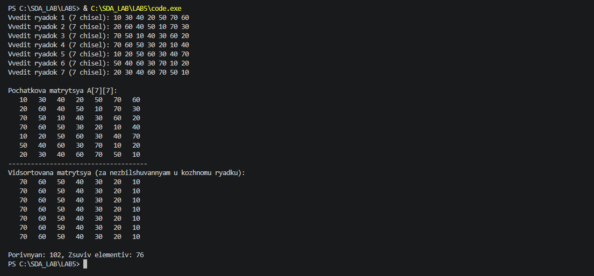
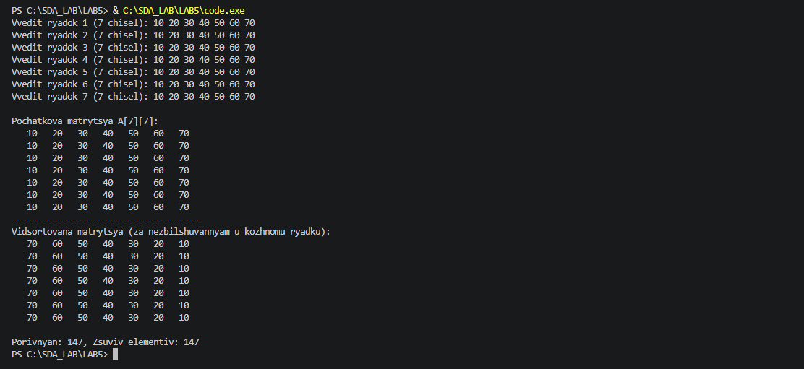

# Структури даних та алгоритми

## Лабораторна робота №5

### Алгоритми сортування

---

### Виконав

**Студент групи:** ІО-61  
**Красько Станіслав**  
**Номер у списку групи:** 12

### Перевірив

**Русінов Володимир Володимирович**

---

## Мета лабораторної роботи

Засвоєння теоретичного матеріалу та набуття практичних навичок розв'язання задачі сортування заданої категорії елементів за допомогою різних алгоритмів сортування у двовимірних масивах

---

## Завдання

Задано двовимірний масив (матрицю) цілих чисел `A[m,n]` або `A[n,n]`, де `m` та `n` — натуральні числа (константи), що визначають розміри масиву. Виконати сортування цього масиву або заданої за варіантом його частини у заданому порядку заданим алгоритмом (методом). Сортування повинно виконуватися безпосередньо у двовимірному масиві «на тому ж місці», тобто без перезаписування масиву та/або його частини до інших одно- чи двовимірних масивів, а також без використання спискових структур даних.
Розміри матриці `m` та `n` взяти самостійно в межах від 7 до 10.

### Умова завдання (варіант №12)

Задано двовимірний масив (матрицю) цілих чисел `A[m,n]`. Відсортувати окремо кожен рядок масиву **алгоритмом №3 методу вставки** (з лінійним пошуком справа з використанням бар'єру) **за незбільшенням**.

---

## Тестування програми

## 1

## 2

## 3

## Висновки У цій лабораторній роботі я реалізував сортування кожного рядка цілочисельної матриці за незбільшенням методом вставки (алгоритм №3) без використання додаткових масивів. Під час тестування на трьох початкових станах (відсортованому, невідсортованому та обернено відсортованому) найменше зсувів відбувається на вже відсортованих за незбільшенням рядках, а найбільше — на обернено відсортованих, що відповідає квадратичній оцінці $O(n^2)$ у гіршому/середньому випадку та лінійній $O(n)$ на рядок у найкращому.